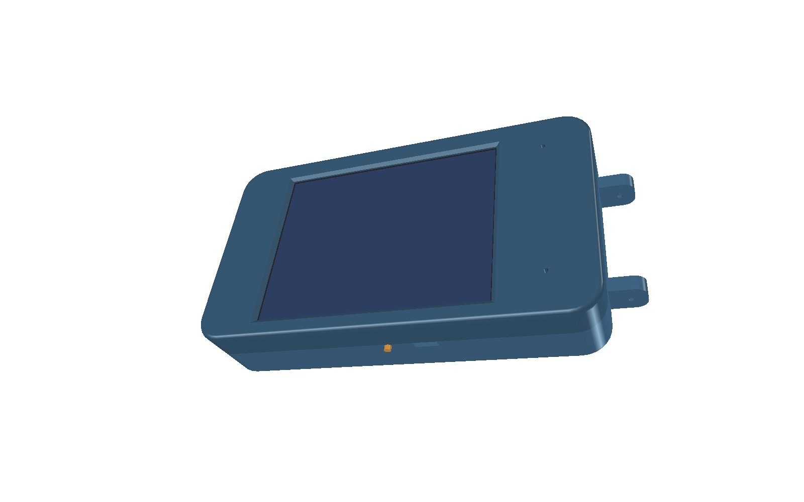
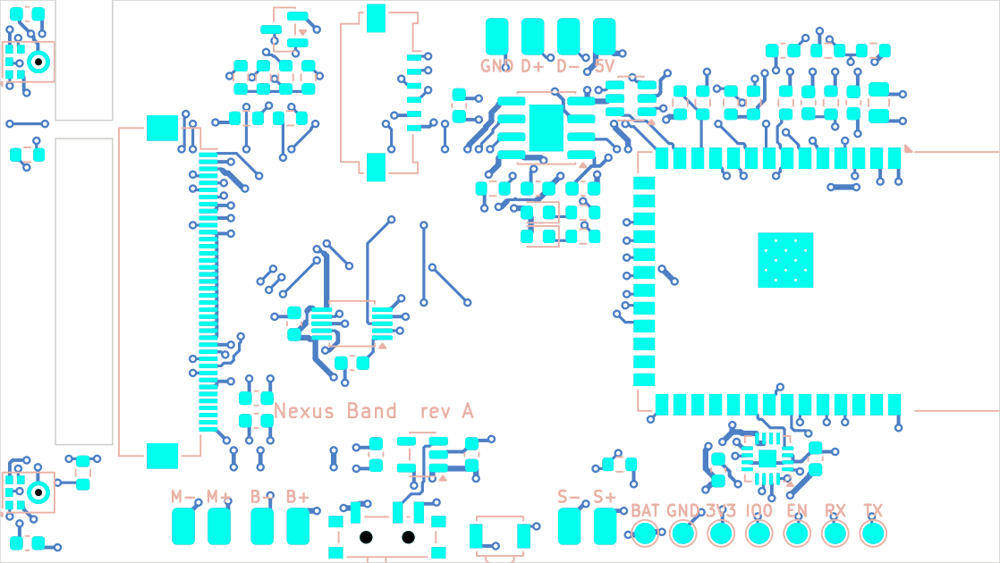
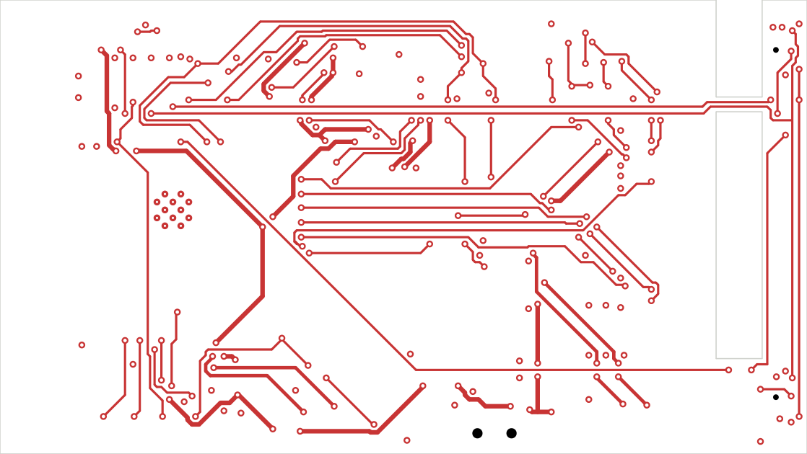
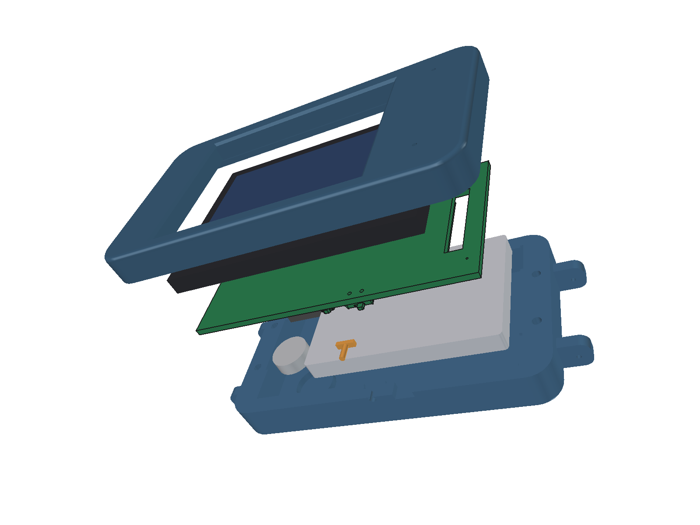
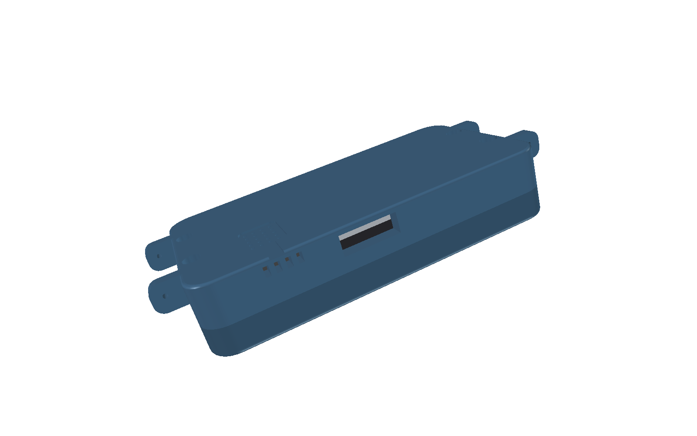

# Nexus Band

A wrist terminal that controls the AI assistant on my laptop. I hold the side button, say what I want ("open Notepad, type this and send it to..."), and the assistant running on the laptop does it. Anything risky comes back to the watch as an Approve / Reject prompt.

Built for **Hack Club Fallen**.



## Why I'm building this

I spend hours at my desk waiting for builds, tests and scripts. The moment I get up, the laptop stops and waits for me to press Enter or approve something. Normal smartwatches only show notifications; they can't run real commands on my computer.

Nexus Band is a remote for my own assistant (ATS 10, a Python program on the laptop). The two talk over the local Wi-Fi, so I can walk around the room and still tell the laptop what to do, see what it is doing, and approve or reject actions from my wrist.

## How the watch and the laptop work together

```
  watch (ESP32-S3)                                laptop (ATS 10)
  ---------------                                 ---------------
  hold button + speak  -- 16 kHz audio (WSS) -->  speech -> assistant -> opens apps,
  tap a quick command  -- JSON command (WSS) -->  types, sends messages, runs commands
  Approve / Reject     -- JSON confirm (WSS) -->  continues or cancels the action
  screen + buzz        <-- activity log, confirmation requests --
```

The watch uses the same API as the assistant's phone dashboard:

| Step | Endpoint | What it carries |
|---|---|---|
| Pair | `POST https://<laptop>:8001/login` | one-time key shown on the laptop, returns a token |
| Commands and status | `wss://<laptop>:8001/ws?token=...` | `{"type":"command","text":"..."}`, `{"type":"confirm","decision":"confirm"}`, and the laptop's log and `confirmation_request` messages |
| Voice | `wss://<laptop>:8001/ws/phone-audio?token=...` | raw 16 kHz 16-bit mono audio from the two microphones |

## Hardware

Everything is on one 4-layer PCB, 71 x 40 mm, that sits behind the display. All parts are on the back, facing the battery; the front is flat against the display.

| Block | Part | Notes |
|---|---|---|
| MCU | ESP32-S3-WROOM-1-N16R8 | Wi-Fi, native USB, 16 MB flash, 8 MB PSRAM |
| Display | Newhaven NHD-2.4-240320AF-CSXP-CTP | 2.4" IPS, 240 x 320, ST7789 over SPI, FT5426 capacitive touch |
| Microphones | 2 x ICS-43434 | I2S, 30 mm apart on the right edge |
| Speaker | MAX98357A + 1511 speaker | I2S class-D amplifier |
| Haptics | DRV2605L + LRA motor | wrist buzz when the laptop needs an answer |
| Power | 1000 mAh Li-Po, TP4056 charger, AP2112K 3.3 V | charges at 400 mA from the dock |
| Dock | 4-pin magnetic pogo connector | 5 V charging and USB for flashing |
| Controls | side button (also BOOT), power slide switch | |

### Power and battery life

- **On / off:** the slide switch on the bottom edge turns the 3.3 V regulator on or off. When it is off, only the charger, the battery divider and the sleeping amplifier and haptic driver stay connected (about 15 µA), so a charged cell keeps for months. Charging on the dock works with the switch in either position.
- **Always on:** the watch is meant to stay switched on and connected all day. The screen turns off after 15 s of no use and comes back on with the side button, a tap, or any message or approval request from the laptop (it also buzzes).
- **Estimated runtime** on the 1000 mAh cell (not measured yet): about 10 h with the screen on the whole time, roughly a day of normal use with the screen sleeping, so it goes on the dock overnight.
- **Low battery:** below 3.35 V and off the dock, the firmware puts the ESP32 into deep sleep to protect the cell.

Size of the watch body: 85 x 48 mm (99 mm across the strap lugs), 17.5 mm thick (bezel 1.0 + display 4.1 + foam 0.5 + PCB 1.6 + parts 3.5 + battery 5.2 + floor 1.4).

### Schematic


PDF: [docs/images/schematic.pdf](docs/images/schematic.pdf)

### PCB

| Back (parts) | Front (display side) |
|---|---|
|  |  |

| 3D, back | 3D, front |
|---|---|
|  |  |

Layer stack: front signal / ground plane / 3.3 V plane / back signal and parts. The strip under the ESP32 antenna has no copper on any layer.

The slot and the notch on the right are for the display's two flex tails. They fold around the board edge and plug into the connectors on the back. Because of that fold the 40-pin connector is numbered backwards compared with the display (connector pad n = display pin 41 - n); the schematic shows both numbers.

KiCad's checks on the files in this repo: [ERC report](docs/erc_report.txt) (0 violations), [DRC report](docs/drc_report.txt) (0 violations, 0 unconnected).

### Pin map

| Function | ESP32-S3 pin |
|---|---|
| Display CS / MOSI / SCK / DC / RST / TE | IO10 / IO11 / IO12 / IO13 / IO14 / IO21 |
| Backlight PWM | IO9 |
| I2C SDA / SCL (touch 0x38, haptics 0x5A) | IO17 / IO18 |
| Touch INT / RST | IO16 / IO15 |
| Microphones SCK / WS / SD | IO5 / IO6 / IO7 |
| Amplifier BCLK / LRCLK / DIN / shutdown | IO40 / IO41 / IO42 / IO39 |
| Battery voltage (1/2 divider) | IO4 |
| Dock detect | IO8 |
| Side button / BOOT | IO0 |
| USB D- / D+ | IO19 / IO20 |

## Case

Three 3D-printed parts (PETG) and a standard 22 mm quick-release strap.

| Assembled | Exploded |
|---|---|
|  |  |

| Back (strap lugs, screws, speaker grille) | Top edge (charging connector, speaker slots) |
|---|---|
|  |  |

| Part | File | What it does |
|---|---|---|
| Front frame | [`cad/front_frame.step`](cad/front_frame.step) | Bezel with the display window, display pocket, PCB pocket, the two microphone holes (with seats for foam gaskets) and the screw pilots |
| Back shell | [`cad/back_shell.step`](cad/back_shell.step) | Battery, speaker and motor bay with locating ribs, a ledge that clamps the PCB edge, button and power-switch openings on the bottom edge, the charging connector pocket and four speaker slots on the top edge, the speaker grille and four 22 mm strap lugs |
| Button cap | [`cad/button_cap.step`](cad/button_cap.step) | Plunger for the side button; its flange sits inside the back shell |

CAD source: [`cad/nexus_band_case.FCStd`](cad/nexus_band_case.FCStd) (FreeCAD 1.1). It also holds the PCB, display, battery, speaker and motor as reference parts. The full assembly as one file: [`cad/nexus_band_assembly.step`](cad/nexus_band_assembly.step).

How it fits together:

- The PCB has no mounting holes, so the case clamps it: the board drops into a 1.6 mm pocket in the front frame and the back shell's 0.8 mm ledge presses on its edge. The ledge is cut away where the ESP32 module, touch connector, switches and microphones reach the edge.
- The display sits face down in the front frame on 0.5 mm foam tape. The window matches its viewing area (49.96 x 37.72 mm), which is 2.5 mm off centre, away from the flex tails.
- Four M2 x 12 self-tapping screws go through the ends of the back shell into the front frame, outside the board.
- Battery in the middle, speaker and motor on the left, nothing over the antenna strip. The speaker stands on 1 mm pads so there is an air gap under it; sound leaves through the floor grille, a shallow channel to the edge, and four slots in the top edge, so it can still be heard when the floor is against the wrist.
- Charging: the magnetic dock connector is glued into the pocket on the top edge, next to the dock pads on the PCB. The cable snaps on from the side; the same connector carries USB for flashing.
- Strap: any 22 mm quick-release watch strap. Its spring bars click into the 1.1 mm holes in the lugs, no tools needed.
- The power switch lever sits in a slot on the bottom edge. Slide it with a fingernail or a toothpick.

Print the front frame face down and the back shell floor down, 0.2 mm layers, no supports.

## Firmware

PlatformIO project in [`firmware/`](firmware). It brings up the display, touch, microphones, speaker and haptics, pairs with the laptop, streams voice while the button is held, and shows the assistant's messages and confirmation prompts.

1. Copy the settings block from `firmware/include/config.h` into a new `firmware/include/config_local.h` and fill in the Wi-Fi name, password, laptop address and the one-time key the laptop shows.
2. Put the watch on the dock, hold the side button while connecting it the first time, then `pio run -t upload`.

The firmware compiles (`pio run`, about 1 MB of the 16 MB flash) but has not run on hardware yet; the board is not built.

## Repository

```
nexus-band/
├── README.md
├── bom.csv                  parts list with links
├── pcb/                     KiCad 10 project
│   ├── nexus_band.kicad_pro / .kicad_sch / .kicad_pcb / .kicad_prl
│   ├── nexus_band.pretty/   footprints for the wire pads
│   ├── gerbers.zip          fabrication files (gerbers + drill)
│   └── nexus_band-pos.csv   pick-and-place positions
├── cad/                     case parts (STEP), FreeCAD source, PCB and assembly models
├── firmware/                ESP32-S3 firmware (PlatformIO)
└── docs/                    schematic PDF, renders, ERC / DRC reports
```

## Bill of materials

About **$224** for the first working watch. That covers a 5-board PCB order with two boards assembled (the factory minimum), the display, battery, speaker, motor, dock connector, strap and case screws, a soldering iron, shipping and import duty. The fees, shipping and duty lines are estimates until the real quotes are in. Full list with links: [`bom.csv`](bom.csv).
