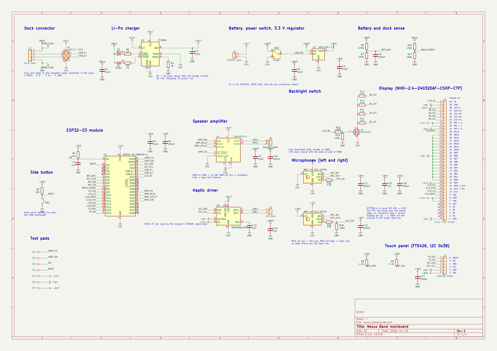
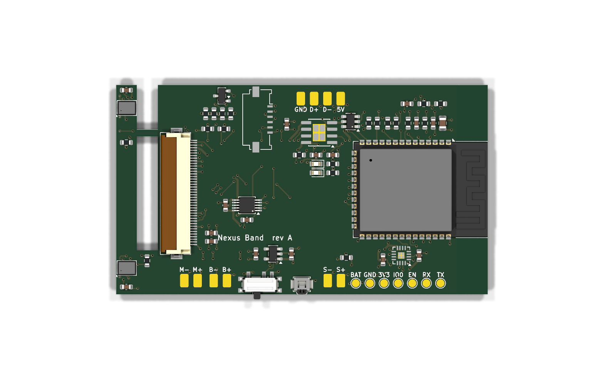
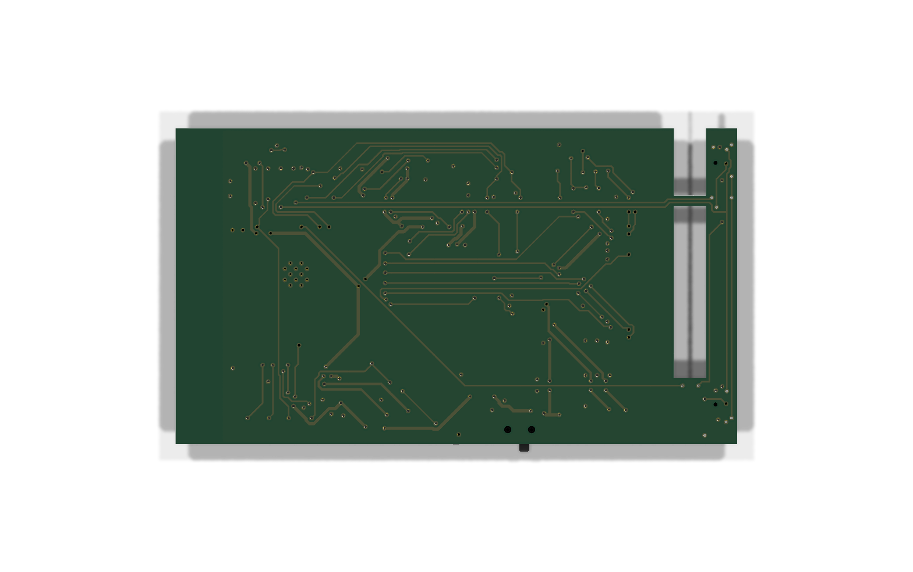
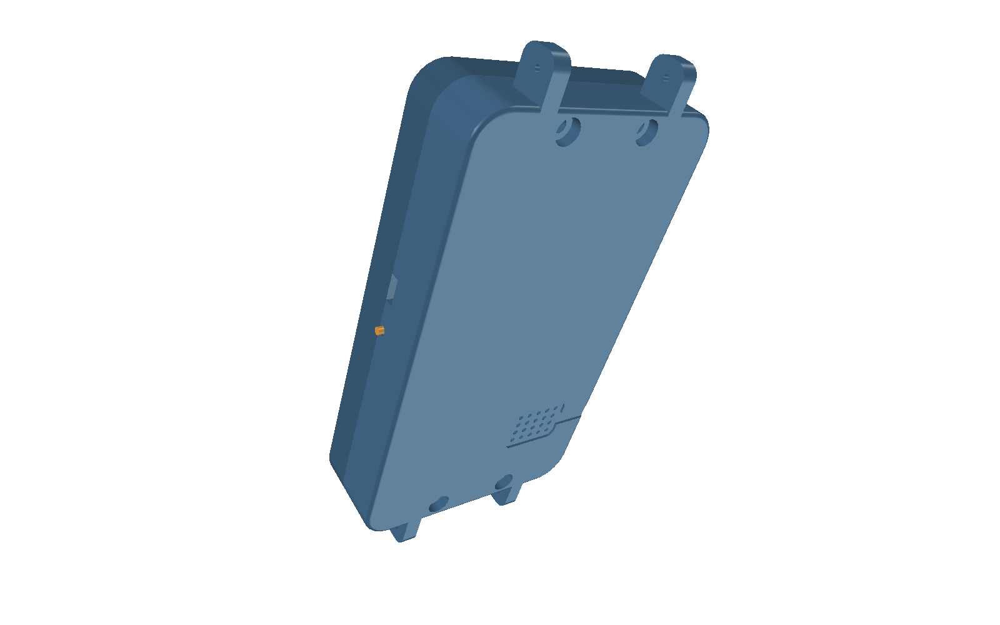

# Nexus Band

A watch that controls the AI assistant on my laptop. I hold the side button and say what I want ("open Notepad, type this and send it to..."), and the assistant on the laptop does it. If an action is risky, the watch asks me first with Approve and Reject buttons.

I'm building it for Hack Club Fallen.


## Why I'm building this

I spend hours at my desk waiting for builds, tests and scripts. When I get up, the laptop sits there until I come back to press Enter or approve something. A normal smartwatch only shows notifications, so it can't help with that.

Nexus Band is a remote for my own assistant, ATS 10, a Python program that runs on the laptop. The watch and the laptop talk over my Wi-Fi. I can walk around the room, tell the laptop what to do, see what it is doing, and approve or reject its actions from my wrist.

## How the watch and the laptop work together

```
  watch (ESP32-S3)                                laptop (ATS 10)
  ---------------                                 ---------------
  hold button + speak  -- 16 kHz audio (WSS) -->  speech -> assistant -> opens apps,
  tap a quick command  -- JSON command (WSS) -->  types, sends messages, runs commands
  Approve / Reject     -- JSON confirm (WSS) -->  continues or cancels the action
  screen + buzz        <-- activity log, confirmation requests --
```

The watch uses the same API as the assistant's phone dashboard:

| Step | Endpoint | What it carries |
|---|---|---|
| Pair | `POST https://<laptop>:8001/login` | one-time key shown on the laptop, returns a token |
| Commands and status | `wss://<laptop>:8001/ws?token=...` | `{"type":"command","text":"..."}`, `{"type":"confirm","decision":"confirm"}`, and the laptop's log and `confirmation_request` messages |
| Voice | `wss://<laptop>:8001/ws/phone-audio?token=...` | raw 16 kHz 16-bit mono audio from the two microphones |

## Hardware

Everything is on one 4-layer PCB, 71 x 40 mm, that sits behind the display. All the parts are on the back, facing the battery, so the front lies flat against the display.

| Block | Part | Notes |
|---|---|---|
| MCU | ESP32-S3-WROOM-1-N16R8 | Wi-Fi, native USB, 16 MB flash, 8 MB PSRAM |
| Display | Newhaven NHD-2.4-240320AF-CSXP-CTP | 2.4" IPS, 240 x 320, ST7789 over SPI, FT5426 capacitive touch |
| Microphones | 2 x ICS-43434 | I2S, 30 mm apart on the right edge |
| Speaker | MAX98357A + 1511 speaker | I2S class-D amplifier |
| Haptics | DRV2605L + LRA motor | wrist buzz when the laptop needs an answer |
| Power | 1000 mAh Li-Po, TP4056 charger, AP2112K 3.3 V | charges at 400 mA from the dock |
| Dock | 4-pin magnetic pogo connector | 5 V charging and USB for flashing |
| Controls | side button (also BOOT), power slide switch | |

### Power and battery life

The slide switch on the bottom edge turns the 3.3 V regulator on and off. With it off, the charger, the battery divider, the amplifier and the haptic driver are still connected, but together they draw about 15 µA, so a charged cell keeps for months. The dock charges the battery with the switch in either position.

I plan to leave the watch switched on and connected all day. The screen turns off after 15 s without use. The side button or a tap wakes it, and so does any message or approval request from the laptop, which also makes the watch buzz.

I haven't measured the runtime yet. My estimate for the 1000 mAh cell is about 10 h with the screen on the whole time and about a day of normal use with the screen sleeping, so it will charge on the dock overnight. If the battery falls below 3.35 V off the dock, the firmware puts the ESP32 into deep sleep to protect the cell.

### Size

The watch body is 85 x 48 mm, or 99 mm across the strap lugs, and 17.5 mm thick. The thickness adds up as bezel 1.0 + display 4.1 + foam 0.5 + PCB 1.6 + parts 3.5 + battery 5.2 + floor 1.4.

### Schematic



PDF: [docs/images/schematic.pdf](docs/images/schematic.pdf)

### PCB

| Back (parts) | Front (display side) |
|---|---|
|  |  |

| 3D, back | 3D, front |
|---|---|
|  |  |

Layer stack: front signal / ground plane / 3.3 V plane / back signal and parts. The strip under the ESP32 antenna has no copper on any layer.

The slot and the notch on the right are for the display's two flex tails. They fold around the board edge and plug into the connectors on the back. That fold reverses the 40-pin connector's numbering: connector pad n is display pin 41 - n. The schematic shows both numbers.

The files in this repo pass KiCad's checks: the [ERC report](docs/erc_report.txt) has 0 violations, and the [DRC report](docs/drc_report.txt) has 0 violations and 0 unconnected pads.

### Pin map

| Function | ESP32-S3 pin |
|---|---|
| Display CS / MOSI / SCK / DC / RST / TE | IO10 / IO11 / IO12 / IO13 / IO14 / IO21 |
| Backlight PWM | IO9 |
| I2C SDA / SCL (touch 0x38, haptics 0x5A) | IO17 / IO18 |
| Touch INT / RST | IO16 / IO15 |
| Microphones SCK / WS / SD | IO5 / IO6 / IO7 |
| Amplifier BCLK / LRCLK / DIN / shutdown | IO40 / IO41 / IO42 / IO39 |
| Battery voltage (1/2 divider) | IO4 |
| Dock detect | IO8 |
| Side button / BOOT | IO0 |
| USB D- / D+ | IO19 / IO20 |

## Case

The case is three parts printed in PETG, and it takes a standard 22 mm quick-release strap.

| Assembled | Exploded |
|---|---|
|  |  |

| Back (strap lugs, screws, speaker grille) | Top edge (charging connector, speaker slots) |
|---|---|
|  |  |

| Part | File | What it does |
|---|---|---|
| Front frame | [`cad/front_frame.step`](cad/front_frame.step) | Bezel with the display window, display pocket, PCB pocket, the two microphone holes (with seats for foam gaskets) and the screw pilots |
| Back shell | [`cad/back_shell.step`](cad/back_shell.step) | Battery, speaker and motor bay with locating ribs, a ledge that clamps the PCB edge, button and power-switch openings on the bottom edge, the charging connector pocket and four speaker slots on the top edge, the speaker grille and four 22 mm strap lugs |
| Button cap | [`cad/button_cap.step`](cad/button_cap.step) | Plunger for the side button; its flange sits inside the back shell |

The CAD source is [`cad/nexus_band_case.FCStd`](cad/nexus_band_case.FCStd), made in FreeCAD 1.1. It also holds the PCB, display, battery, speaker and motor as reference parts. The whole assembly is in one file, [`cad/nexus_band_assembly.step`](cad/nexus_band_assembly.step).

### How it fits together

The PCB has no mounting holes, so the case clamps it. The board drops into a 1.6 mm pocket in the front frame, and a 0.8 mm ledge on the back shell presses on its edge. The ledge is cut away where the ESP32 module, the touch connector, the switches and the microphones reach the edge.

The display sits face down in the front frame on 0.5 mm foam tape. The window matches its viewing area, 49.96 x 37.72 mm, which sits 2.5 mm off centre, away from the flex tails.

Four M2 x 12 self-tapping screws go through the ends of the back shell into the front frame. They pass outside the board.

The battery is in the middle and the speaker and motor are on the left. Nothing sits over the antenna strip. The speaker stands on 1 mm pads, which leaves an air gap under it. Sound leaves through the floor grille, a shallow channel to the edge, and four slots in the top edge, so it can still be heard when the floor is against the wrist.

The magnetic dock connector is glued into the pocket on the top edge, next to the dock pads on the PCB. The cable snaps on from the side, and the same connector carries USB for flashing.

Any 22 mm quick-release strap fits. Its spring bars click into the 1.1 mm holes in the lugs without tools.

The power switch lever sits in a slot on the bottom edge. It slides with a fingernail or a toothpick.

### Printing

Print the front frame face down and the back shell floor down, with 0.2 mm layers and no supports.

## Firmware

The firmware is a PlatformIO project in [`firmware/`](firmware). It starts the display, touch, microphones, speaker and haptics, then pairs with the laptop. While I hold the button it streams my voice, and it shows the assistant's messages and confirmation prompts on the screen.

To flash it:

1. Copy the settings block from `firmware/include/config.h` into a new `firmware/include/config_local.h` and fill in the Wi-Fi name, password, laptop address and the one-time key the laptop shows.
2. Put the watch on the dock, hold the side button while connecting it the first time, then `pio run -t upload`.

The firmware compiles with `pio run` and takes about 1 MB of the 16 MB flash. It has not run on hardware yet, because the board is not built.

## Repository

```
nexus-band/
├── README.md
├── bom.csv                  parts list with links
├── pcb/                     KiCad 10 project
│   ├── nexus_band.kicad_pro / .kicad_sch / .kicad_pcb / .kicad_prl
│   ├── nexus_band.pretty/   footprints for the wire pads
│   ├── gerbers.zip          fabrication files (gerbers + drill)
│   └── nexus_band-pos.csv   pick-and-place positions
├── cad/                     case parts (STEP), FreeCAD source, PCB and assembly models
├── firmware/                ESP32-S3 firmware (PlatformIO)
└── docs/                    schematic PDF, renders, ERC / DRC reports
```

## Bill of materials

The first working watch costs about $224. That pays for a 5-board PCB order with two boards assembled, which is the factory minimum. It also covers the display, battery, speaker, motor, dock connector, strap and case screws, a soldering iron, shipping and import duty. The fees, shipping and duty lines are estimates until I have real quotes. The full list with links is in [`bom.csv`](bom.csv).
